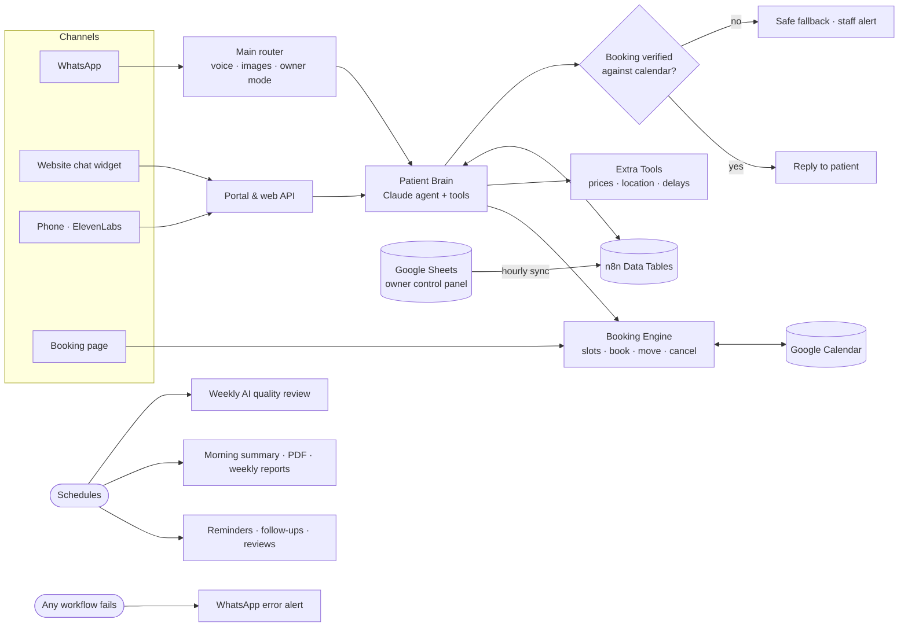
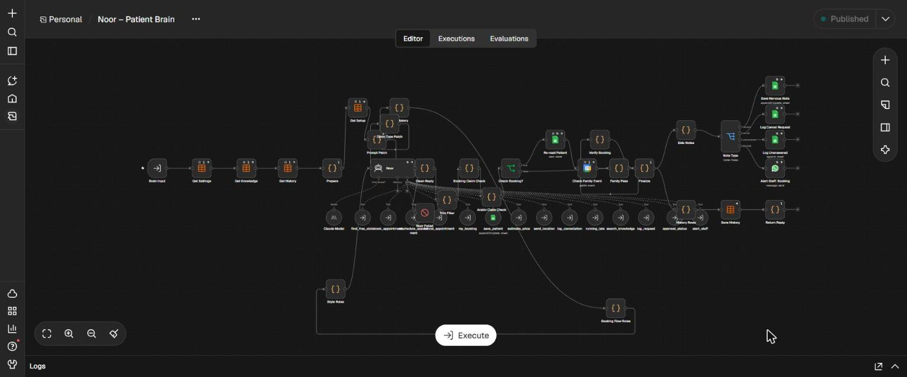
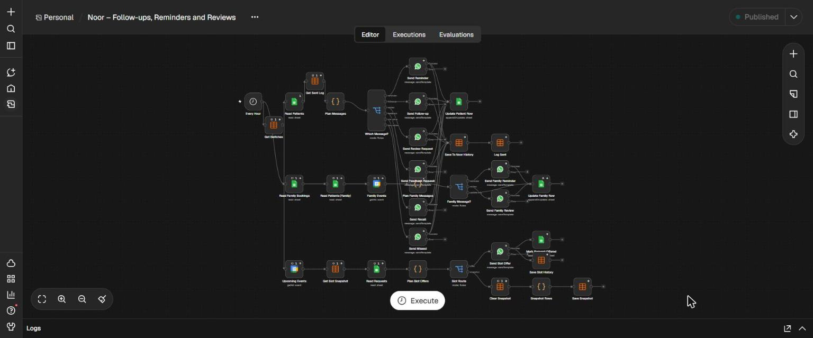

# Halora — AI Front Desk for Clinics

**An agentic AI receptionist and clinic operations platform: WhatsApp, website chat, voice and phone, booking, follow-ups, owner portal and multi-clinic onboarding — built end to end in n8n with the Claude API.**

    

🌐 **Live site:** [askhalora.com](https://askhalora.com) · ✉️ ziad.elhoseiny@askhalora.com

Designed, built and maintained by **Ziad Elhoseiny**, AI Automation & n8n Specialist.

---

## At a glance

| | |
|---|---|
| **Problem** | Clinics lose patients to unanswered WhatsApp messages, missed calls and after-hours enquiries. Staff spend hours booking by hand, chasing confirmations and following up no-shows. |
| **Solution** | An AI receptionist answers patients 24/7 in English and Arabic, books real appointments in the clinic calendar, follows up automatically and keeps the owner informed. Every channel feeds one system. |
| **Scale** | 18 production workflows · 588 nodes · 40 webhook endpoints · 8 scheduled jobs · multi-clinic |
| **My role** | Sole builder: discovery with clinics, architecture, AI agent and prompts, automations, front ends, testing, deployment and maintenance |

## What it does

### For patients
- **AI receptionist on WhatsApp ("Noor")**: answers questions about services, prices, doctors, hours and location in English or Arabic, in a natural, short WhatsApp style.
- **Voice notes in, voice replies out**: transcribes patient voice notes, with a backup transcriber, and can answer with a spoken reply.
- **Insurance card reading**: Claude vision reads a photo of the patient's insurance card.
- **Real booking**: finds free slots per doctor in Google Calendar, then books, reschedules and cancels, including family bookings, with no double-booking.
- **Price estimates and instalments**, location pins and "running late" notices.
- **Website chat widget**: an embeddable script for the clinic's site, with voice-note support and the same AI brain.
- **Self-service booking page** and an **AI phone receptionist** (ElevenLabs) that write into the same calendar.
- **Missed-call text-back**: a missed call triggers an automatic WhatsApp message so the patient isn't lost.

### For the clinic owner and staff
- **Owner portal** with secure login: dashboard, live inbox, requests, campaigns and call transcripts.
- **Human takeover**: staff can pause the AI on any chat and reply from the inbox; the AI can also draft replies for approval.
- **WhatsApp campaigns** to patient lists using approved templates, with results tracking.
- **Daily briefing and reports**: a morning summary on WhatsApp, a daily PDF report and weekly and monthly business summaries (patients, after-hours replies, bookings, unanswered questions).
- **Owner commands over WhatsApp**: `#schedule`, `#requests`, `#leads`, `#done` and more, answered by a separate Claude agent.
- **Automated follow-ups**: reminders 24 h and 2 h before visits, post-booking follow-ups and Google review requests.
- **Google Sheet as the control panel**: owners edit services, prices, doctors and FAQs in a sheet, and an hourly sync loads it into fast n8n Data Tables.

### Halora platform (multi-clinic SaaS)
- **Marketing site in English and Arabic** with lead capture and intro-call booking (Google Calendar, WhatsApp confirmation and a 1-hour reminder).
- **Self-onboarding**: a clinic fills in the setup form, and the system builds its assistant prompt, configures its voice agent, creates its website and portal links and sends them to the owner.
- **Admin dashboard API** to list clinics and switch features on or off per clinic, protected by an admin key.
- **Sales tooling**: clinic lead lists from OpenStreetMap, plus domain and DNS checks for new clinic sites.

## Architecture

**How a WhatsApp message flows**
1. The WhatsApp trigger receives the message. The **Main** router transcribes voice notes, reads images and detects owner commands.
2. **Patient Brain** loads clinic settings, knowledge and conversation history, then runs a Claude agent with tools: find free slots, book, reschedule, cancel, look up a booking, save the patient, estimate a price, send the location, log a request, alert staff.
3. Code guards check the reply. Any booking the AI claims is verified against the real calendar, filler phrases are trimmed and Arabic replies are checked.
4. The conversation is saved, staff alerts go out if needed and the reply is sent as text or voice.

## Engineering decisions

| Decision | Why |
|---|---|
| **Tools as sub-workflows** | The agent calls the booking engine and other tools as separate n8n workflows, so each tool can be tested, versioned and switched off on its own. |
| **Deterministic booking engine** | The LLM never calculates availability. Slots come from code over Google Calendar, so double-booking is impossible. |
| **Verify, don't trust** | A post-check compares what the AI says against the calendar before the patient sees it. |
| **Right model per job** | Claude Sonnet for patient conversations, Claude Haiku for owner commands and quality reviews (cheaper and faster), Gemini for voice transcription with a fallback. |
| **Sheets as the admin UI, Data Tables at runtime** | Owners edit a familiar spreadsheet, and the AI reads fast local tables synced hourly. |
| **Feature switches** | Each tool and each clinic can be turned on or off from data, with no workflow edits. |
| **Templates for outbound** | Reminders and campaigns use Meta-approved templates, so they're delivered outside the 24-hour window. |

## Security, testing and reliability

- **Secrets:** API keys live in n8n credentials, never in workflow code. Portal passwords are salted and hashed, and sessions use HMAC-signed tokens that expire after 7 days. Admin endpoints require a key.
- **Input validation:** every webhook checks its payload and returns clear errors.
- **Test suite:** test conversations run through the AI brain without sending anything, are scored and saved, and must pass before a change goes live.
- **Monitoring:** a global error workflow sends the owner the failing workflow, step and error on WhatsApp.
- **Quality loop:** every week Claude reviews real conversations and suggests up to five improvements.
- **Data hygiene:** a daily job removes demo and test chats, and patient data stays in the clinic's own Google account.
- **Safe changes:** each change is published as a named version, so it can be rolled back.

## Workflows

### `workflows/noor-whatsapp-receptionist/`
| # | Workflow | Purpose |
|---|---|---|
| 01 | Main | WhatsApp entry point: voice notes, insurance cards, owner mode, voice replies, fallbacks |
| 02 | Patient Brain | Claude agent with 12 tools, booking verification, reply guards, conversation memory |
| 03 | Booking Engine | Free slots, book, reschedule, cancel, look up, family bookings (Google Calendar) |
| 04 | Extra Tools | Price estimates and instalments, location, running late, cancellation log |
| 05 | Owner Mode | Claude Haiku agent for the owner's `#` commands |
| 06 | Online Booking | Public booking page with instant owner notification |
| 07 | Follow-ups, Reminders and Reviews | 24 h / 2 h reminders, follow-ups and review requests via templates |
| 08 | Morning Summary | Daily briefing: today's appointments, confirmations, new leads, patients awaiting staff |
| 09 | Owner Portal | Portal login, dashboard, inbox and takeover, campaigns, requests, web chat widget, voice agent, missed calls, PDF reports, sales site |
| 10 | Weekly Quality Report | Claude reviews conversations and proposes improvements |
| 11 | Sync Sheets to Data Tables | Hourly sync of the owner's Google Sheet |
| 12 | Error Alert | WhatsApp alert for any failed workflow |
| 13 | Test Suite | Scores AI answers to test conversations without sending messages |

### `workflows/halora-platform/`
| # | Workflow | Purpose |
|---|---|---|
| 01 | Pilot Intake | Receives the clinic setup form from askhalora.com |
| 02 | Clinic Auto-Setup | Builds a clinic's assistant, voice agent and links from the form |
| 03 | Clinic Chat | Website AI chat for any clinic, with appointment requests |
| 04 | Clinic API | One API for clinic websites, owner portals and the phone receptionist |
| 05 | Admin API | Admin dashboard backend: list clinics, switch features |

## Tech stack

| Area | Tools |
|---|---|
| Orchestration | n8n: webhooks, schedules, sub-workflows, AI Agent and tool nodes, Data Tables, error workflows |
| AI | Claude API (Sonnet, Haiku, vision, tool calling), Gemini (speech-to-text), OpenAI (text-to-speech), ElevenLabs (voice agent, Scribe) |
| Integrations | WhatsApp Cloud API and templates, Google Calendar, Google Sheets, PDF.co, SMTP, OpenStreetMap |
| Code | JavaScript (112 Code nodes), HTML/CSS, SQL-style data modelling |
| Front end | Website, portal and widgets in HTML/JS on GitHub Pages, built with Claude Code |

## Screenshots

**Patient Brain: Claude agent with booking tools and verification guards**

**Follow-ups, Reminders and Reviews: hourly scheduler sending approved WhatsApp templates**

## Run it yourself

1. In n8n, choose **Import from file** and pick a workflow from `workflows/`.
2. Add your own WhatsApp Cloud API, Anthropic, Google and ElevenLabs credentials.
3. Replace the placeholders (`REPLACE_ME`, `YOUR_PHONE_NUMBER_ID`, `YOUR-INSTANCE`, `your-webhook-path`) with your own values.

> Exported files contain no credentials, phone numbers, account IDs or patient data.

## Contact

**Ziad Elhoseiny** · ziad.elhoseiny@askhalora.com · [askhalora.com](https://askhalora.com)
